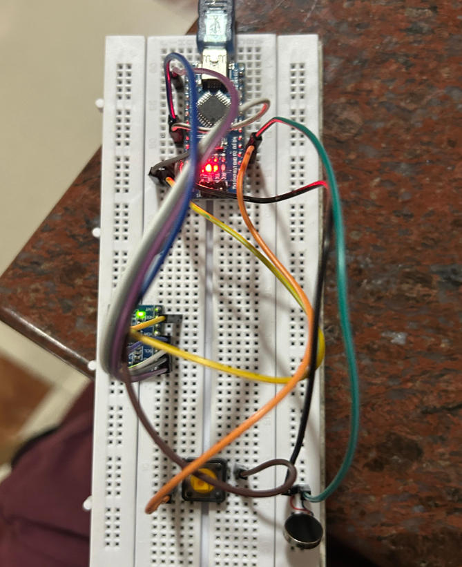
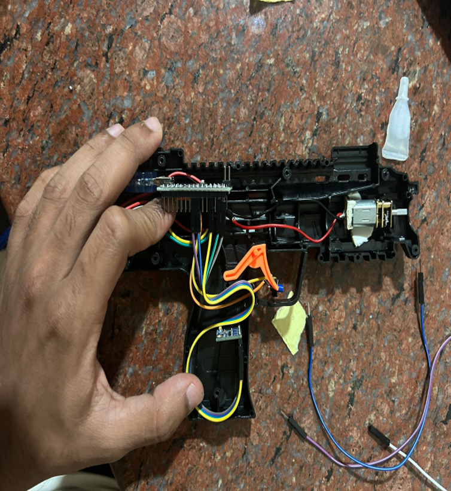

# Multipurpose Gyroscopic Defence System

**Python-based PC control system integrated with ESP32 and MPU6050 for motion sensing and wireless interaction.** The project combines gyroscopic motion tracking, physical buttons, vibration feedback, Bluetooth HID, and Python-based PC control to create a multipurpose motion-controlled interface for PC applications and games.

## 📌 Project Overview

The Multipurpose Gyroscopic Defence System is a motion-based control system developed using an **ESP32** and **MPU6050 gyroscope/accelerometer**.

The system captures hand movement through the MPU6050 and converts the detected motion into control inputs. Physical buttons provide additional user interaction, while a vibration motor provides feedback during operation.

The project also includes a **Python-based PC controller** for the earlier serial-control implementation.

## 🛠️ Technologies Used

- **Python** – PC-side control and serial communication
- **ESP32** – Main microcontroller
- **MPU6050** – Gyroscope and accelerometer
- **Bluetooth HID** – Wireless PC interaction
- **Arduino/C++** – ESP32 firmware
- **Serial Communication** – PC-controller interface
- **GPIO Buttons** – User input
- **Vibration Motor** – Haptic feedback

## 🔧 Hardware Components

- ESP32 development board
- MPU6050 sensor
- Push buttons
- Vibration motor
- Breadboard
- Jumper wires
- USB cable
- Prototype housing

## ⚙️ System Architecture

```text
             ┌─────────────────┐
             │     MPU6050     │
             │ Gyroscope + IMU │
             └────────┬────────┘
                      │
                      ▼
             ┌─────────────────┐
             │      ESP32      │
             │ Motion Control  │
             └───────┬─────────┘
                     │
          ┌──────────┴──────────┐
          │                     │
          ▼                     ▼
   ┌─────────────┐      ┌─────────────┐
   │   Buttons   │      │  Vibration  │
   │ User Input  │      │  Feedback   │
   └─────────────┘      └─────────────┘
          │
          ▼
   ┌─────────────────┐
   │ Bluetooth HID / │
   │ Serial Interface│
   └────────┬────────┘
            │
            ▼
      ┌────────────┐
      │     PC     │
      │ Application│
      │   / Game   │
      └────────────┘

Python PC Controller
        │
        └── Serial-based control interface
```

## 🖼️ Hardware Prototype

### Breadboard Implementation



### Integrated Gyroscopic System



## 🔌 Pin Configuration

| Component | ESP32 GPIO |
|---|---:|
| Left Button | GPIO 25 |
| Right Button | GPIO 26 |
| Vibration Motor | GPIO 27 |
| MPU6050 SDA | I²C SDA |
| MPU6050 SCL | I²C SCL |

## 💻 Project Structure

```text
Multipurpose_gyroscopic_defence_system/
│
├── ESP32/
│   └── gyroscopic_defence_system.ino
│
├── Python/
│   ├── pc_controller.py
│   └── requirements.txt
│
├── Images/
│   ├── prototype_breadboard.jpg
│   └── gyroscopic_system.jpg
│
├── README.md
└── .gitignore
```

## 🚀 How It Works

1. The **MPU6050** detects rotational movement.
2. The **ESP32** reads and processes the sensor data.
3. Physical buttons provide additional control inputs.
4. The vibration motor provides haptic feedback.
5. The processed input is transmitted to the PC through the selected control interface.
6. The PC converts the input into application/game controls.
7. The Python controller is included for the serial-based PC control implementation.

## 🐍 Python Component

The `Python/` directory contains the PC-side controller used with the serial communication implementation.

Install the required Python packages using:

```bash
pip install -r requirements.txt
```

The Python controller can then be used with the corresponding serial interface and configured COM port.

## 📱 ESP32 / Bluetooth HID

The ESP32 implementation provides wireless HID functionality, allowing the system to interact with a PC without requiring the Python controller for the Bluetooth HID implementation.

The ESP32 firmware is located at:

```text
ESP32/gyroscopic_defence_system.ino
```

## 🎥 Project Demonstration

Demo video:

**Coming soon — YouTube demonstration link will be added here.**

## 📸 Project Images

Prototype and hardware implementation images are available in the `Images/` directory.

## 🔮 Future Improvements

- Improve motion-control accuracy and filtering
- Add adjustable sensitivity
- Improve wireless range and stability
- Develop a dedicated PC configuration interface
- Add additional programmable controls
- Improve enclosure and ergonomics
- Expand compatibility with more PC applications and games

## 👨‍💻 Author

**Nandha Kishor V**

Electronics and Communication Engineering

Christ University

---

⭐ If you find this project interesting, feel free to explore the source code and implementation.
